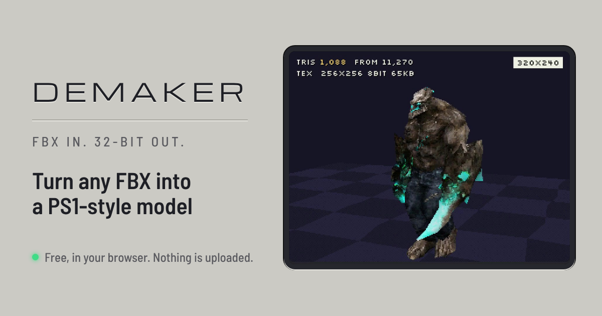

# Demaker

**FBX in. 32-bit out.** Turn any FBX into a PS1-style model, in your browser.

**Try it: https://toltecs101.github.io/demaker/**

## What it does

- **Cuts the mesh to a triangle budget.** Pick anything from 60 to 12,000 triangles.
- **Repaints the texture onto one small page.** 32 to 512 px, with a 16-color or 256-color palette, 15-bit color, or full color.
- **Keeps the rig and every animation clip.**
- **Previews it the way the console drew it:** 320×240, vertices snapped to whole pixels, textures mapped without perspective correction, and the hardware's 4×4 dither pattern.
- **Exports a `.glb`** with the mesh, skeleton, animations and texture.

Four presets: Demake, PS1 '95, PS1 '99 and PS2 '01.

Everything runs on your device. Your files are never uploaded.

## How to use it

1. Open the site and choose **Open FBX**. If the FBX keeps its textures as separate image files, select them together with it, or add them afterwards.
2. Pick a preset, then adjust triangles, texture size and colors.
3. Choose **Export .glb**.

In your engine, set texture filtering to nearest (point), turn mipmaps off, and render to a 320×240 target. The wobble, the texture warp and the dither are things the console did while drawing, so they belong in a shader rather than in the file.

## How it works

1. **Weld by position.** FBX meshes arrive split wherever UVs, normals or materials change. Welding corners by position alone gives the simplifier one continuous surface.
2. **Decimate** with [meshoptimizer](https://github.com/zeux/meshoptimizer), using the build that ships with three.js.
3. **Unwrap** the low-poly mesh by direction. Each connected patch that faces the same way (front, back, sides, top, bottom) becomes one flat piece of texture.
4. **Bake.** Every pixel of the new texture page looks up the nearest point on the original model and takes its color.
5. **Reduce color** to a palette (median cut, then k-means) with ordered dithering, in 15-bit color.
6. **Preview** with a shader that snaps vertices to the pixel grid, interpolates UVs without perspective correction, and applies the PS1 dither table before cutting color to 5 bits per channel.

## Limits

- Reads FBX only and exports `.glb` only.
- Blend shapes (morph targets) are dropped.
- The preview does not imitate the PS1's depth-sorting errors.
- Needs WebGL 2 and WebAssembly, and an internet connection to load three.js.

## Run it yourself

It is one file, `index.html`, with no build step. Serve this folder with any static web server and open it.

## Credits

- [three.js](https://threejs.org) (MIT) for rendering, FBX loading and glTF export.
- [meshoptimizer](https://github.com/zeux/meshoptimizer) (MIT) for mesh simplification.
- Inspired by [PSXIFY](https://lil-qk.itch.io/psxify).
- Built by VOIDMONKX with Claude.

## License

MIT. See [LICENSE](LICENSE).
